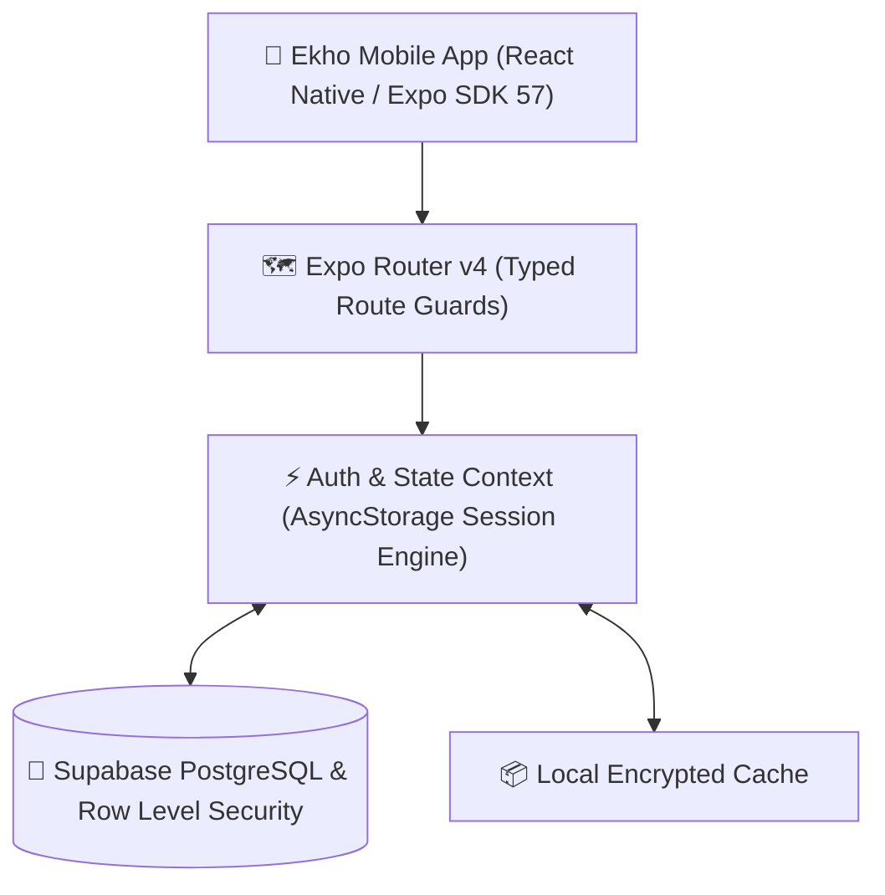

# Ekho — Speech-Language Pathology (SLP) Telepractice & Discovery Platform

<div align="center">


[](https://expo.dev)
[](https://reactnative.dev)
[](https://www.typescriptlang.org)
[](https://supabase.com)
[](LICENSE)

**Better Communication Starts Here.**  
A specialized mobile ecosystem connecting caregivers and children with verified Speech-Language Pathologists (SLPs), online telepractice video rooms, pediatric milestone tracking, and nearby physical therapy clinics.

[Features](#-core-features) • [Tech Stack](#-technical-architecture) • [Database & Security](#-database-schema--rls) • [Getting Started](#-getting-started) • [Test Accounts](#-test-credentials--seed-data) • [Project Structure](#-project-structure)

</div>

---

## 🌟 Executive Summary

**Ekho** bridges the gap between families navigating pediatric speech delays and certified clinical specialists. Designed following evidence-based speech-language pathology principles and HIPAA-compliant data standards, Ekho serves three distinct user roles:

1. **Parents & Caregivers:** Seamless discovery of licensed SLPs, transparent hourly pricing, one-tap teletherapy booking, progress analytics, and local clinic map navigation.
2. **Speech-Language Pathologists (Clinicians):** Dedicated practice management tools including caseload tracking, weekly availability scheduling, session SOAP note generation, and earnings/payout analytics.
3. **Clinical Administrators:** Rigorous credential verification pipeline (ASHA CCC-SLP, state board license checks) and platform governance.

---

## 🎯 Core Features

### 1. Parent & Discovery Ecosystem
- **Hero & Discovery Hub:** Instant category-driven querying across 8 key pediatric speech domains:
  - *Speech Sound Disorders (Articulation & Phonology)*
  - *Language Delays (Expressive & Receptive)*
  - *Fluency & Stuttering*
  - *Childhood Apraxia of Speech (CAS)*
  - *Autism Spectrum & Social Communication*
  - *Early Intervention (Ages 0–3)*
  - *Voice & Resonance Disorders*
  - *Feeding & Swallowing (Pediatric Dysphagia)*
- **Multi-Facet SLP Marketplace:** Real-time filtering engine by clinical specializations, years of experience, spoken languages (English, Spanish, Hindi, etc.), hourly fee brackets, age groups treated, and board verification status.
- **Detailed Clinician Profiles:** Clinical philosophy, verified state license numbers, academic qualifications, treatment methodologies (PROMPT, PECS, Play-Based), availability previews, and verified parent reviews.
- **Nearby Clinics Directory:** Dual **List** and **Interactive Map** modes displaying local pediatric therapy centers, audiology departments, and hospital outpatient clinics with instant distance calculation and direct calling.

### 2. End-to-End Booking & Checkout Funnel
- **4-Step Booking Engine:**
  - *Step 1:* Dynamic child selection (persists across sessions).
  - *Step 2:* Date & slot scheduling with morning/afternoon availability chips.
  - *Step 3:* Flexible consultation duration (30, 45, or 60 minutes) with auto-computed fees.
  - *Step 4:* Clinical intake concerns and therapist focus goals.
- **Simulated Payment Gateway:** Multi-rail checkout supporting Credit/Debit Cards, UPI (Google Pay / PhonePe / UPI ID), and Net Banking with itemized platform breakdowns, reference code generation, and calendar synchronization.
- **Caregiver Appointment Manager:** Status-segmented views (*Upcoming*, *Past / Completed*, *Cancelled*) with countdown timers, one-tap video room join buttons, rescheduling, and cancellation workflows with automated refund notices.

### 3. Pediatric Records & Objective Progress Tracking
- **Child Profile Management:** Multi-child records capturing developmental history, birth dates, primary diagnoses, and sensory preferences.
- **Individualized Therapy Goals:** Longitudinal target accuracy metrics tracking baseline vs. current performance vs. mastery criteria.
- **Post-Session SOAP Reports:** Clinician accuracy scores, cueing levels required (*Minimal*, *Moderate*, *Maximal*), completed activities, and home practice exercises assigned to parents.

### 4. Clinician Practice Suite (SLP Portal)
- **Practice Overview & Analytics:** Daily scheduled consultations, active client roster, hourly rate management, and average review ratings.
- **Weekly Schedule Configurator:** Day-by-day availability toggles, working hours, and inter-session buffer time rules.
- **Appointment Queue:** Real-time triage with instant *Accept* or *Decline* controls.
- **Financial Earnings Dashboard:** Withdrawable balances, pending payouts, completed consultation counts, and itemized transaction receipts.

---

## 🛠 Technical Architecture



| Layer | Technology | Purpose |
| :--- | :--- | :--- |
| **Mobile Runtime** | React Native 0.86.3, Expo SDK 57 | Cross-platform iOS, Android, and Web deployment |
| **Routing** | Expo Router v4 (File-based) | Modular role-segregated navigation with layout guards |
| **Language** | TypeScript 5.x | Strict type safety across clinical models and UI |
| **Database** | Supabase (PostgreSQL 15) | Relational data persistence with Row-Level Security (RLS) |
| **Local Storage** | `@react-native-async-storage` | Session persistence, demo state, offline capabilities |
| **Design System** | Custom Pediatric Healthcare System | Calming teals (`#0D9488`), blues (`#0284C7`), rounded cards |
| **Icons & Media** | `@expo/vector-icons` (Ionicons, MCO, FA5) | Accessible, lightweight iconography |

---

## 🔒 Database Schema & RLS

The database is built on relational integrity and strict pediatric privacy:

- `profiles`: Core identity table mapping to `auth.users` with role discriminator (`parent`, `slp`, `admin`).
- `slp_profiles`: Credentials, ASHA certification numbers, years of experience, hourly rates, and verification status.
- `child_profiles`: Pediatric patient records securely constrained to parent ownership.
- `appointments`: Teletherapy consultation scheduling, duration, status, and payment metadata.
- `session_reports`: Structured clinical SOAP documentation (accuracy percentage, notes, home assignments).
- `child_goals`: Individualized therapy targets with numerical accuracy progress trackers.

### Row-Level Security (RLS) Policies
- **Caregivers:** Full CRUD on their owned child profiles and appointments.
- **SLPs:** Read-only access *strictly* to child profiles with whom they have an active or accepted appointment.
- **Public:** Can query verified SLP marketplace cards and nearby clinical directory entries.

---

## 🚀 Getting Started

### Prerequisites
- Node.js (v18.0 or newer)
- npm, yarn, or bun
- [Expo Go](https://expo.dev/go) app on your iOS or Android physical device, or an active simulator.

### Installation

1. **Clone the repository:**
   ```bash
   git clone https://github.com/jdbruh18/Ekho.git
   cd Ekho
   ```

2. **Install project dependencies:**
   ```bash
   npm install
   ```

3. **Configure Environment Variables (Optional for local Supabase):**
   Create a `.env` file in the root directory:
   ```env
   EXPO_PUBLIC_SUPABASE_URL=https://your-project.supabase.co
   EXPO_PUBLIC_SUPABASE_ANON_KEY=your-anon-key
   ```
   *(Note: Ekho includes pre-bundled offline mock data so you can immediately run and test all screens without setting up an external database.)*

4. **Launch the development server:**
   ```bash
   npx expo start
   ```

5. **Run on your device:**
   - Scan the terminal QR code with your device camera (iOS) or the Expo Go app (Android).
   - Press `i` to open in iOS Simulator, `a` for Android Emulator, or `w` for Web.

---

## 👥 Test Credentials & Seed Data

The app is pre-configured with seamless one-tap demo authentication and sample accounts:

| Role | Email | Password | Pre-loaded Records |
| :--- | :--- | :--- | :--- |
| **Parent / Caregiver** | `emily.watson@parent.test` | `parent123` | Child: Leo Watson (Age 5), Scheduled teletherapy session, baseline goals |
| **Speech Pathologist** | `maya.lin@slp.test` | `clinician123` | Verified status, 4 active clients, schedule, earnings of \$2,280 |
| **Clinical Admin** | `admin@talkstep.test` | `admin123` | Clinician license verification queue |

*Quick Demo Tip: On the Login screen, use the quick role switcher chips to instantly test each user role.*

---

## 📁 Project Structure

```text
├── assets/                     # App icons, splash screens, and illustrations
├── supabase/
│   ├── migrations/
│   │   └── 001_initial_schema.sql  # Database tables, foreign keys & RLS policies
│   └── seed.sql                # Seed dataset with verified SLPs, clinics & goals
├── src/
│   ├── app/                    # Expo Router route hierarchy
│   │   ├── _layout.tsx         # Root provider, splash handling & auth provider
│   │   ├── index.tsx           # Launch router and session dispatcher
│   │   ├── (auth)/             # Authentication & onboarding flow
│   │   │   ├── landing.tsx     # Ekho brand landing & public features
│   │   │   ├── role-select.tsx # Role selection (Caregiver vs. Clinician)
│   │   │   ├── parent-signup.tsx # Parent account & initial child setup
│   │   │   ├── slp-register.tsx  # Clinician license & rate intake
│   │   │   └── login.tsx       # Unified credentials sign-in
│   │   ├── (parent)/           # Parent & Public Discovery Ecosystem
│   │   │   ├── _layout.tsx     # Parent navigation stack & role guard
│   │   │   ├── index.tsx       # Caregiver discovery home & categories
│   │   │   ├── find-slp.tsx    # Multi-facet SLP marketplace filter
│   │   │   ├── slp/[id].tsx    # Detailed clinical profile view
│   │   │   ├── book-session.tsx# Multi-step booking funnel
│   │   │   ├── appointments.tsx# Appointments & teletherapy launcher
│   │   │   ├── children.tsx    # Child profiles & pediatric history
│   │   │   ├── progress.tsx    # Longitudinal therapy milestones & SOAP logs
│   │   │   └── clinics.tsx     # Nearby physical clinics (List & Map view)
│   │   ├── (slp)/              # Speech Pathologist Clinical Portal
│   │   │   ├── _layout.tsx     # SLP navigation stack & clinical guard
│   │   │   ├── index.tsx       # Practice dashboard & KPI cards
│   │   │   ├── clients.tsx     # Authorized client caseload & RLS badge
│   │   │   ├── sessions.tsx    # SOAP documentation & clinical notes
│   │   │   ├── calendar.tsx    # Weekly schedule & request queue
│   │   │   └── earnings.tsx    # Financial analytics & withdrawal modal
│   │   └── (admin)/            # Administrative Console
│   ├── components/             # Reusable atomic UI components
│   │   ├── ui/                 # Buttons, Cards, Inputs, Badges
│   │   ├── checkout/           # PaymentModal & fee breakdown
│   │   ├── Header.tsx          # Clean header with back-action
│   │   └── DisclaimerBanner.tsx# Clinical & HIPAA disclaimer
│   ├── constants/
│   │   └── theme.ts            # Calming pediatric palette, typography & spacing
│   ├── lib/
│   │   ├── auth-context.tsx    # Global session & appointment store
│   │   ├── mock-data.ts        # Seed clinical profiles, reviews & clinics
│   │   ├── supabase.ts         # Supabase client instantiation
│   │   └── uuid.ts             # RFC 4122 compliant UUID v4 generator
│   └── types/
│       ├── auth.ts             # Session, credentials & role definitions
│       └── database.ts         # TypeScript mappings for Supabase tables
├── app.json                    # Expo application manifest
├── package.json                # Project dependencies and npm scripts
└── tsconfig.json               # TypeScript compiler configuration
```

---

## 🩺 Clinical & Legal Disclaimer

*Ekho is a telepractice software platform designed to facilitate communication between licensed speech-language professionals and clients. Ekho is not a direct healthcare provider or hospital. Information, assessments, and progress milestones recorded on Ekho do not constitute an automated medical diagnosis. All clinical determinations are performed independently by licensed, treating Speech-Language Pathologists.*

---

## 📄 License

This project is licensed under the MIT License - see the [LICENSE](LICENSE) file for details.
